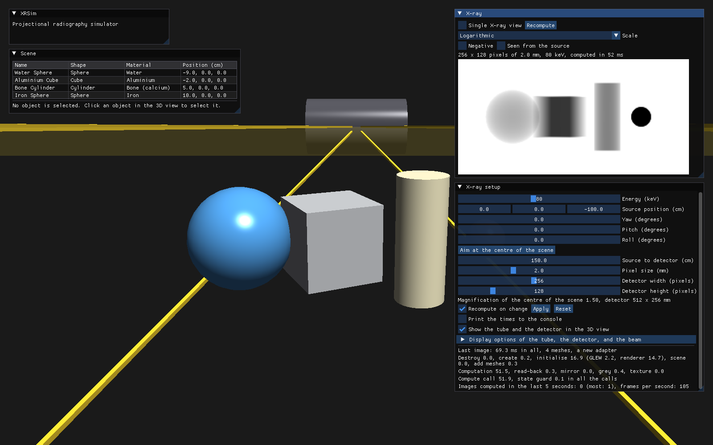
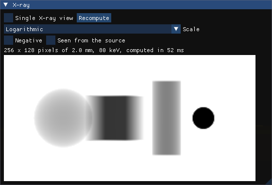
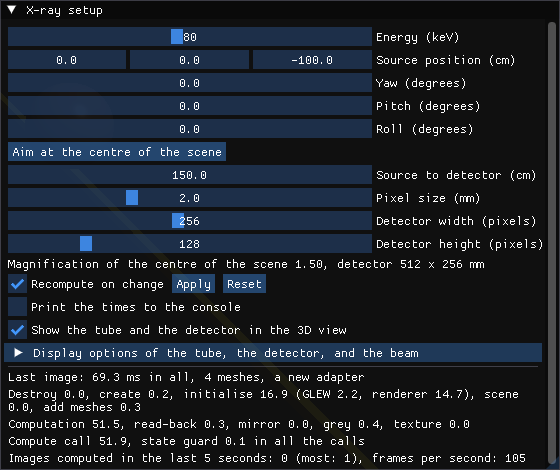

# Projectional Radiography Simulator

[](https://isocpp.org/)
[](https://www.opengl.org/)
[](https://github.com/emartg/xray-sim/actions/workflows/ci.yml)
[](https://cmake.org/)
[](https://opensource.org/licenses/MIT)
[](https://github.com/emartg/opengl-graphics-engine/releases/tag/v0.9.0)
[](https://github.com/emartg/gvirtual-xray/tree/23591ef67398f750c18473aa0e65a22883992abc)

Desktop application that uses a custom OpenGL graphics engine, the gVirtualXRay library and ImGui, among other tools and libraries.
It allows radiology professionals and students to test X-ray scanning and imaging in a virtual environment.

## Screenshots



*The main window with the default scene: the Engine's 3D view of the objects (a water sphere, an aluminium cube, and a bone cylinder; the iron sphere is behind the setup window) with the X-ray tube and the edges of its beam, and, on the right, the X-ray image and its setup.*

| X-ray image | X-ray setup |
|---|---|
|  |  |
| *The X-ray image of the four objects, computed by gVirtualXRay on the Engine's OpenGL context (80 keV, 256 by 128 pixels of 2 mm, logarithmic scale).* | *The setup of the beam and the detector: the energy, the free position and direction of the tube, the source-to-detector distance, the pixels, and the time of each stage of the last image.* |

The captures were taken on a virtual display with software OpenGL (Mesa), so the times that they show are longer than on a graphics card.

## Repository Structure

- `engine/`: Git submodule with the [OpenGL graphics engine](https://github.com/emartg/opengl-graphics-engine) (`Engine::Core` and `Engine::Platform`).
- `gvirtual-xray/`: Git submodule with the [fork of gVirtualXRay](https://github.com/emartg/gvirtual-xray) that computes the X-ray images.
- `src/`: the code of the simulator, which connects both: the application (`src/app`), the description of the scenes, the materials, and the X-ray setup (`src/scene`), the conversion of an X-ray image to grey values (`src/display`), and the library that adapts gVirtualXRay (`src/xray`).
- `tests/`: the tests of the simulator's libraries and of its build.
- `cmake/`: the vcpkg triplets of the MinGW presets and of the continuous integration, and the check that the submodules are at the commits that the repository records.
- `CHANGELOG.md`: the changes of the project, version by version.
- `docs/`: documentation (the build instructions, the credits of the third-party libraries and resources, the captures of the program, in `docs/images/`, and the diagrams, in `docs/diagrams/`, whose [README](docs/diagrams/README.md) says how they are rendered and checked).

The simulator depends on the engine and on gVirtualXRay. The engine never depends on, or mentions, the simulator or gVirtualXRay. The [architecture overview](docs/diagrams/uml/architecture_overview.png) shows the modules of the simulator and how they use the two, and the [diagrams' index](docs/diagrams/README.md) lists the diagram of each module.

## Getting the Sources

gVirtualXRay stores large assets with Git LFS, so [install Git LFS](https://git-lfs.com) before cloning:

```
git lfs install
git clone --recurse-submodules https://github.com/emartg/xray-sim.git
```

If the repository was cloned without `--recurse-submodules`, run `git submodule update --init --recursive`. The engine's resources and the LFS assets are large (hundreds of megabytes), so the first clone takes a while.

## Status

Early prototype. The simulator is built on the engine and on gVirtualXRay, and it already connects them: it shows a scene of simple shapes (a sphere of water, a rotated cube of aluminium, a cylinder of bone, and a small sphere of iron) drawn by the engine, and the X-ray image of the same scene, which gVirtualXRay computes. The image is shown in a window beside the normal view, or as the whole window. A second window sets the energy of the beam, the position of the X-ray tube and where it points (the detector follows the beam, at a distance that can be set, and can be turned about it), and the number of pixels and the pixel size of the detector, and the image is computed again when a value changes. These controls, like the ones of the objects, are free geometry: their limits only keep the scene valid and are not tied to a medical limit. The normal view also shows the X-ray tube, the detector plate at its real size, and the edges and the volume of the beam, which follow the setup; each of them can be hidden, coloured, and made transparent, and their sizes changed. The mouse moves the camera of the normal view: a drag with the right button turns it about the selected object (or about the centre of the scene when nothing is selected), a drag with the middle button moves it across the view, and the wheel brings it closer or farther. A click on an object in the normal view selects it, and the `Scene` window then shows its data and lets you change its material and its position, rotation, and scale, which the X-ray image follows. The scale of the image can be linear or logarithmic, and negative, and the image can be seen from the detector (looking back at the source, as the first 3D view looks) or from the source (looking along the beam, the mirror image).

The simulator is built and tested on Linux (GCC and Clang) and on Windows (MinGW and MSVC), and CMake checks that the two submodules are at the commits that the repository records. Next is a first pre-release (v0.1.0). The medical features (exam types, patients, exposure, image quality, dose, and exercises) are not designed yet. See [docs/build_instructions.md](docs/build_instructions.md) to build and run it.

## Assets and Credits

The third-party libraries and resources of the simulator are credited, with their authors, sources, and licenses, in [docs/sources.md](docs/sources.md). The engine and the gVirtualXRay fork have their own files: [engine/docs/sources.md](https://github.com/emartg/opengl-graphics-engine/blob/main/docs/sources.md) and [gvirtual-xray/docs/sources.md](gvirtual-xray/docs/sources.md).
